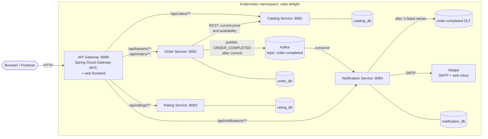
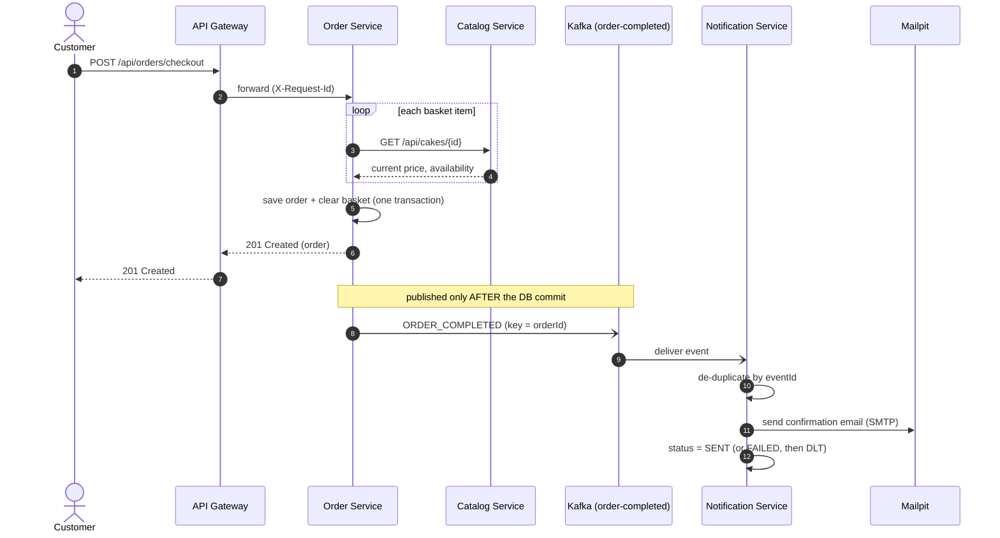

# 🎂 Cake Delight – Cloud-Native Microservices

Cake Delight is an online cake shop built as a **cloud-native microservices application**.
Customers can browse and filter cakes, manage a shopping basket, check out, rate cakes, and
receive an order confirmation, all through a single API Gateway.

The project shows independent services with their own databases, REST and event-driven
communication (Kafka), containerisation (Docker), and orchestration (Kubernetes).

---

## Table of contents
1. [Features](#features)
2. [Architecture](#architecture)
3. [Services](#services)
4. [Tech stack](#tech-stack)
5. [Repository structure](#repository-structure)
6. [How to run](#how-to-run)
7. [Using the application](#using-the-application)
8. [API documentation](#api-documentation)
9. [Event-driven flow](#event-driven-flow)
10. [Data model](#data-model)
11. [Reliability and design decisions](#reliability-and-design-decisions)
12. [Monitoring](#monitoring)
13. [Testing](#testing)
14. [Screenshots](#screenshots)
15. [Future improvements](#future-improvements)

---

## Features

| Customer journey | Implemented by |
|---|---|
| Browse cakes (paginated, sortable) | Catalog Service |
| Filter by name, category, price range, availability | Catalog Service (JPA Specifications) |
| Add cakes to the basket, update quantities, remove items | Order Service |
| Checkout and create an order (prices re-checked with Catalog) | Order Service |
| Track order status (`PLACED → CONFIRMED → PREPARING → OUT_FOR_DELIVERY → DELIVERED`, or `CANCELLED`) | Order Service |
| Rate cakes (1–5, one rating per user per cake) and see averages | Rating Service |
| Order confirmation email plus in-app notification inbox | Notification Service (Kafka consumer) |
| Single entry point and minimal web UI | API Gateway |

---

## Architecture



_Image version: [docs/images/architecture.png](docs/images/architecture.png)_

**Key principles**

- **Single entry point**: clients only talk to the API Gateway. The services are internal (Kubernetes ClusterIP).
- **Database per service**: each service owns its schema and its own MySQL user. No service reads another service's database.
- **No cross-service foreign keys**: Rating and Order refer to cakes by `cakeId` only. Order **snapshots** the name and price at checkout, so order history never depends on Catalog.
- **Synchronous where an answer is needed now** (Order → Catalog for the current price); **asynchronous where it isn't** (Order → Kafka → Notification).
- **Configuration from the environment**: the same Docker image runs locally, in Docker Compose and in Kubernetes. Only environment variables differ.

---

## Services

| Service | Port | Responsibility | Database | Talks to |
|---|---|---|---|---|
| **api-gateway** | 8080 | Routing, request IDs, access logging, serves the web UI | – | All services |
| **catalog-service** | 8081 | Cake CRUD, filtering, pagination, seed data | `catalog_db` | – |
| **order-service** | 8082 | Basket, checkout, orders, status state machine | `order_db` | Catalog (REST), Kafka (producer) |
| **rating-service** | 8083 | Ratings and average ratings | `rating_db` | – |
| **notification-service** | 8084 | Consumes order events, sends email, delivery status, in-app inbox | `notification_db` | Kafka (consumer), Mailpit (SMTP) |

---

## Tech stack

| Area | Technology |
|---|---|
| Language / framework | Java 21, Spring Boot 4.1 |
| Web / REST | Spring Web MVC, Bean Validation, ProblemDetail (RFC 9457) error responses |
| Persistence | Spring Data JPA, Hibernate 7, MySQL 8.4 |
| Messaging | Apache Kafka 4.1 (KRaft mode), Spring for Apache Kafka |
| Gateway | Spring Cloud Gateway Server Web MVC |
| HTTP client | Spring `RestClient` with connect/read timeouts |
| Email | Spring Mail + Mailpit (local SMTP server with web inbox) |
| API docs | springdoc-openapi 3 (Swagger UI) |
| Observability | Spring Boot Actuator (health, liveness, readiness), Micrometer + Prometheus endpoint |
| Containers | Docker (multi-stage builds, non-root user), Docker Compose |
| Orchestration | Kubernetes (Minikube): Deployments, Services, ConfigMaps, Secrets, PVC, probes, init containers |
| Frontend | Plain HTML, CSS and JavaScript, served by the gateway |
| Build | Maven (wrapper) |

---

## Repository structure

```
cake-delight/
├── api-gateway/             # Spring Cloud Gateway + static web UI (src/main/resources/static)
├── catalog-service/
├── order-service/
├── rating-service/
├── notification-service/
│   └── (each service: src/, pom.xml, Dockerfile, .dockerignore)
├── docker/
│   └── mysql/init.sql       # creates the 4 databases and users
├── docker-compose.yml       # full stack with one command
├── k8s/
│   ├── 00-namespace.yaml
│   ├── 01-config.yaml       # ConfigMap: service URLs, Kafka, mail
│   ├── 02-secrets.yaml      # DB credentials (local demo only)
│   ├── infra/               # mysql, kafka, mailpit
│   └── apps/                # the 5 services
├── docs/
│   ├── api/                 # OpenAPI specs + endpoint reference
│   ├── events/              # Kafka event contract
│   ├── database-schema.md
│   ├── demo-script.md
│   └── screenshots/
└── postman/                 # Postman collection
```

---

## How to run

### Prerequisites
- **Docker Desktop** (WSL2 backend on Windows), with at least **4 GB** of memory available to Docker
- For Kubernetes: **Minikube** and **kubectl**
- For local development only: **JDK 21** and an IDE (IntelliJ IDEA)

### Option A: Docker Compose (simplest)

```bash
docker compose up -d --build
docker compose ps          # wait until mysql and kafka are "healthy" and all services are "Up"
```

| URL | What |
|---|---|
| http://localhost:8080 | Web UI and API (through the gateway) |
| http://localhost:8025 | Mailpit inbox (order confirmation emails) |
| `localhost:3307` (root / rootpass) | MySQL, for inspection with MySQL Workbench |

Stop with `docker compose down`, or `docker compose down -v` to also delete the database volume.

### Option B: Kubernetes (Minikube)

```bash
# 1. Start a cluster (4 GB is enough with the provided resource settings)
minikube start --driver=docker --cpus=2 --memory=4096

# 2. Build the images inside Minikube
minikube image build -t cake-delight/catalog-service:1.0      ./catalog-service
minikube image build -t cake-delight/order-service:1.0        ./order-service
minikube image build -t cake-delight/rating-service:1.0       ./rating-service
minikube image build -t cake-delight/notification-service:1.0 ./notification-service
minikube image build -t cake-delight/api-gateway:1.0          ./api-gateway

# 3. Deploy infrastructure first, then the services
kubectl apply -f k8s/00-namespace.yaml
kubectl apply -f k8s/01-config.yaml -f k8s/02-secrets.yaml
kubectl apply -R -f k8s/infra/
kubectl config set-context --current --namespace=cake-delight
kubectl get pods -w                      # wait for mysql, kafka, mailpit to be 1/1
kubectl apply -R -f k8s/apps/
kubectl get pods -w                      # wait for all 8 pods to be 1/1 Running

# 4. Open the app (each command in its own terminal)
kubectl port-forward svc/api-gateway 8080:8080
kubectl port-forward svc/mailpit 8025:8025
```

Then open http://localhost:8080 and http://localhost:8025.

### Option C: Local development (IDE)

1. Start the infrastructure:
   ```bash
   docker run -d --name local-mysql -e MYSQL_ROOT_PASSWORD=<password> -p 3306:3306 mysql:8.4
   docker run -d --name kafka   -p 9092:9092 apache/kafka:4.1.0
   docker run -d --name mailpit -p 1025:1025 -p 8025:8025 axllent/mailpit
   ```
2. Create the databases and users with `docker/mysql/init.sql` (for example, in MySQL Workbench).
3. Run each `*Application` class from the IDE. The local defaults in each `application.yaml` point to `localhost`.

---

## Using the application

Open **http://localhost:8080**, enter a **User ID** and **email** at the top, then:

1. **Browse and filter** cakes by name, category, price range or availability, and sort them.
2. **Add to basket**, change quantities, or remove items.
3. **Checkout**. The order appears under *My orders* as `PLACED`.
4. About a second later the **notification** appears as `SENT`, and the email arrives in **Mailpit**.
5. **Rate** a cake. The average rating updates on the card.

---

## API documentation

All endpoints are available through the gateway at `http://localhost:8080`.
See **[docs/api/README.md](docs/api/README.md)** for the full endpoint list. The OpenAPI specs are in `docs/api/*.json`.

Swagger UI is available on each service when it runs locally:

| Service | Swagger UI |
|---|---|
| Catalog | http://localhost:8081/swagger-ui.html |
| Order | http://localhost:8082/swagger-ui.html |
| Rating | http://localhost:8083/swagger-ui.html |
| Notification | http://localhost:8084/swagger-ui.html |

All errors use the standard **ProblemDetail** format (`application/problem+json`), for example:

```json
{
  "title": "Validation failed",
  "status": 400,
  "detail": "One or more fields are invalid",
  "instance": "/api/cakes",
  "errors": { "name": "Name is required", "price": "Price must be greater than 0" }
}
```

---

## Event-driven flow



_Image version: [docs/images/checkout-sequence.png](docs/images/checkout-sequence.png)_

- **Event contract:** [docs/events/order-completed.md](docs/events/order-completed.md)
- **Topic:** `order-completed` (3 partitions, key = `orderId`). Dead-letter topic: `order-completed.DLT`
- **Delivery:** at-least-once. The consumer is **idempotent** (unique `eventId`).

---

## Data model

Each service owns its own database. See **[docs/database-schema.md](docs/database-schema.md)** for all tables, columns, keys and indexes.

| Database | Tables |
|---|---|
| `catalog_db` | `cakes` |
| `order_db` | `baskets`, `basket_items`, `orders`, `order_items` |
| `rating_db` | `ratings` |
| `notification_db` | `notifications` |

---

## Reliability and design decisions

| Concern | How it is handled |
|---|---|
| **Validation** | Bean Validation on request DTOs (`@NotBlank`, `@DecimalMin`, `@Digits`, …) plus database constraints (`NOT NULL`, unique keys) |
| **Consistent errors** | A `@RestControllerAdvice` per service returns RFC 9457 ProblemDetail with correct status codes (400, 404, 409, 503, 500) |
| **Dependency failures** | Order → Catalog uses connect/read **timeouts**. A Catalog outage returns **503**, and viewing baskets and orders keeps working thanks to snapshots |
| **Price integrity** | Clients never send prices. Prices come from Catalog and are **re-checked at checkout** |
| **Atomic checkout** | Creating the order and clearing the basket happen in **one transaction**. Any failure rolls back both |
| **Concurrent updates** | `@Version` **optimistic locking** on orders (409 on conflicting updates) |
| **Order lifecycle** | A status **state machine** in the `OrderStatus` enum rejects invalid transitions (409) |
| **Events only for real orders** | `@TransactionalEventListener(AFTER_COMMIT)`: no event if checkout rolls back |
| **Duplicate events** | The Notification consumer is **idempotent**: a unique `event_id` plus an existence check |
| **Temporary failures** | Kafka `DefaultErrorHandler` with **exponential backoff** (1 s, 2 s, 4 s) |
| **Permanent failures** | After the retries, status `FAILED` is recorded and the message goes to the **dead-letter topic**. Malformed messages go straight to the DLT |
| **Duplicate ratings** | A service check plus a DB unique constraint `(cake_id, user_id)` → 409 |
| **Tracing a request** | The gateway adds an **`X-Request-Id`** header (returned to the client and forwarded downstream) and logs every request with its latency |
| **Kubernetes health** | Startup, **liveness** and **readiness** probes on Actuator endpoints. Init containers wait for MySQL and Kafka |
| **Container security** | Images run as a **non-root** user. Multi-stage builds keep the build tools out of runtime images |

---

## Monitoring

Every service exposes Spring Boot Actuator endpoints:

| Endpoint | Purpose |
|---|---|
| `/actuator/health` | Overall health, including the database (and mail for Notification) |
| `/actuator/health/liveness` | Used by the Kubernetes liveness probe |
| `/actuator/health/readiness` | Used by the Kubernetes readiness probe |
| `/actuator/prometheus` | Metrics in Prometheus format (HTTP latency, JVM, connection pool, Kafka), all tagged with `application=<service-name>` |

Useful Kafka check (consumer lag):

```bash
docker compose exec kafka /opt/kafka/bin/kafka-consumer-groups.sh \
  --bootstrap-server localhost:9092 --describe --group notification-service
```

---

## Testing

- **Postman collection:** `postman/cake-delight.postman_collection.json` plus the environment `postman/cake-delight-local.postman_environment.json` (`baseUrl = http://localhost:8080`). Import both, select the environment, and run the **E2E Journey** folder with the Collection Runner. It creates a fresh user each run, so it can be repeated.
- **API spec export:** `scripts\export-api-docs.cmd` saves each service's OpenAPI spec into `docs/api/` (Kubernetes must be running).
- **Demo script:** [docs/demo-script.md](docs/demo-script.md), a step-by-step end-to-end walkthrough, including failure scenarios.

---

## Screenshots

| | |
|---|---|
| Web UI after checkout |  |
| Order confirmation email (Mailpit) |  |
| Kubernetes pods |  |
| Swagger UI |  |

---

## Future improvements

- **Transactional Outbox** for Order → Kafka, so an event is never lost if Kafka is down at commit time (the current design logs the failure).
- **Circuit breaker and retries** (Resilience4j) for Order → Catalog and in the gateway.
- **Authentication and authorisation** (OAuth2 / JWT at the gateway). Today the user ID is passed explicitly.
- **Database migrations with Flyway** instead of `ddl-auto: update`.
- **Real secret management** (Sealed Secrets / External Secrets) instead of plain Kubernetes Secrets in Git.
- **CI/CD pipeline** (GitHub Actions) to build, test and publish images on every push.
- **Distributed tracing** (Micrometer Tracing + OpenTelemetry) and a **Grafana** dashboard.
- **Kafka and MySQL as StatefulSets** with persistent storage and replicas. **Ingress** instead of port-forward.
- A batch endpoint for rating summaries (the UI currently makes one call per cake).

---

## Author

_Your name_ – Capstone project, Cloud-Native Microservices Engineering
