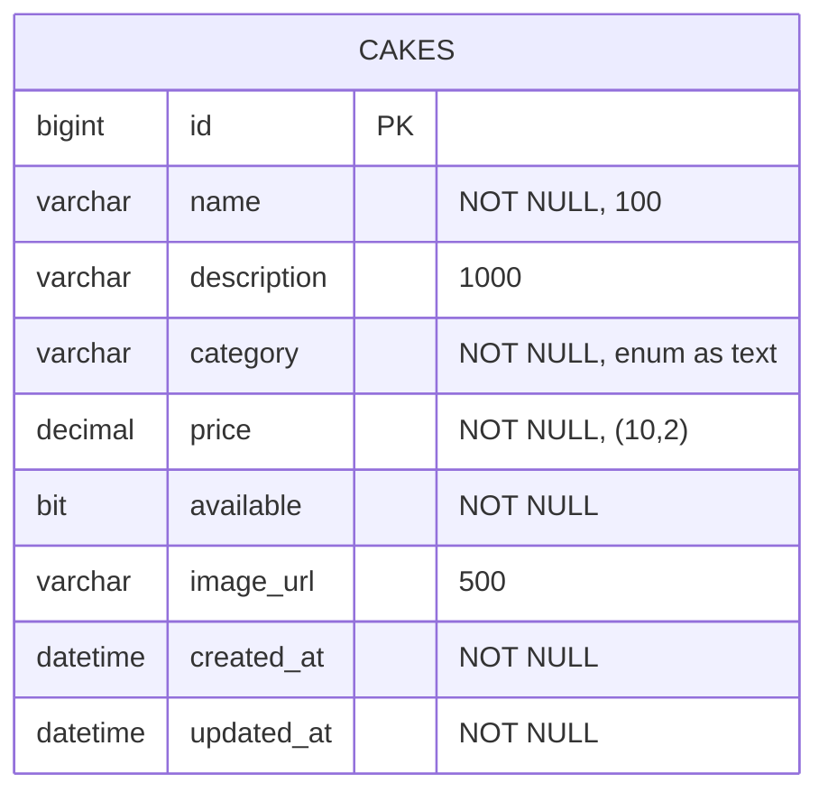
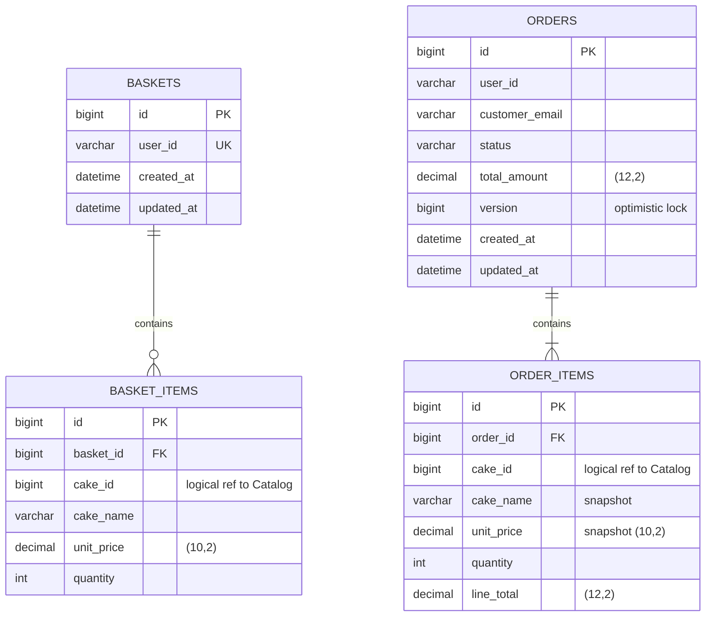
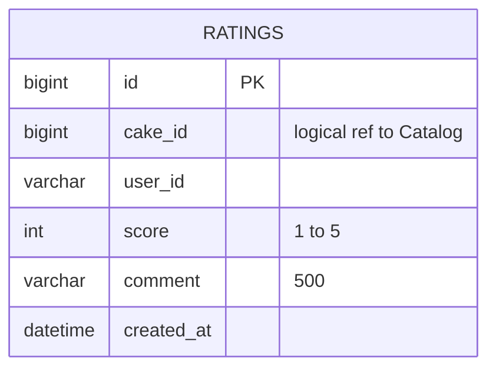
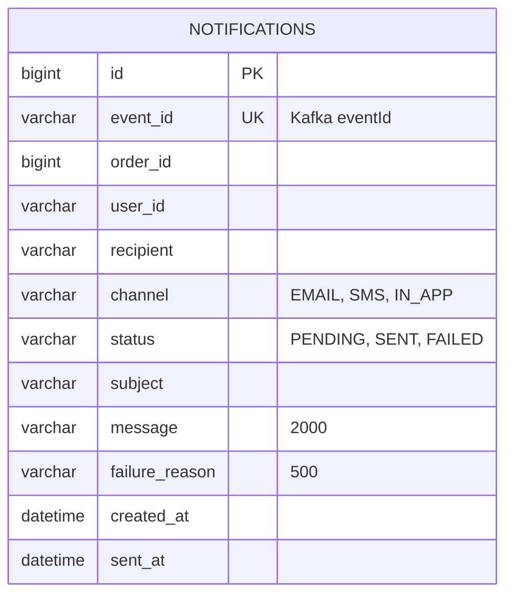

# Database schema / data model

Each microservice owns **its own MySQL database and user** (database-per-service).
Tables are created by Hibernate from the JPA entities (`ddl-auto: update`).

> **No foreign keys across services.** `cake_id` in Order and Rating is a *logical*
> reference to Catalog. It is not enforced by the database, because the cakes live in a
> different database. Order stores a **snapshot** of the cake name and price instead.

| Database | Owner service | DB user | Tables |
|---|---|---|---|
| `catalog_db` | catalog-service | `catalog_user` | `cakes` |
| `order_db` | order-service | `order_user` | `baskets`, `basket_items`, `orders`, `order_items` |
| `rating_db` | rating-service | `rating_user` | `ratings` |
| `notification_db` | notification-service | `notification_user` | `notifications` |

---

## catalog_db

_Image version: [images/er-catalog.png](images/er-catalog.png)_

### `cakes`
| Column | Type | Constraints | Notes |
|---|---|---|---|
| `id` | BIGINT | PK, AUTO_INCREMENT | |
| `name` | VARCHAR(100) | NOT NULL | |
| `description` | VARCHAR(1000) | | |
| `category` | VARCHAR(30) | NOT NULL, CHECK in enum values | `BIRTHDAY`, `WEDDING`, `ANNIVERSARY`, `PASTRY`, `CUPCAKE`, `CUSTOM` (stored as text, not ordinal) |
| `price` | DECIMAL(10,2) | NOT NULL | `BigDecimal` in Java (exact money arithmetic) |
| `available` | BIT(1) | NOT NULL | default `true` |
| `image_url` | VARCHAR(500) | | |
| `created_at` | DATETIME(6) | NOT NULL | set on insert |
| `updated_at` | DATETIME(6) | NOT NULL | set on every update |

---

## order_db

_Image version: [images/er-order.png](images/er-order.png)_

### `baskets`
| Column | Type | Constraints |
|---|---|---|
| `id` | BIGINT | PK, AUTO_INCREMENT |
| `user_id` | VARCHAR(100) | NOT NULL, **UNIQUE** (one basket per user) |
| `created_at` | DATETIME(6) | NOT NULL |
| `updated_at` | DATETIME(6) | NOT NULL |

### `basket_items`
| Column | Type | Constraints |
|---|---|---|
| `id` | BIGINT | PK, AUTO_INCREMENT |
| `basket_id` | BIGINT | NOT NULL, **FK → baskets.id** |
| `cake_id` | BIGINT | NOT NULL |
| `cake_name` | VARCHAR(100) | NOT NULL |
| `unit_price` | DECIMAL(10,2) | NOT NULL |
| `quantity` | INT | NOT NULL (1–20, enforced by the API) |

Unique key `uk_basket_item_cake (basket_id, cake_id)`: a cake appears once per basket, and adding it again increases the quantity.
Basket totals are **calculated on read**, not stored.

### `orders`
| Column | Type | Constraints |
|---|---|---|
| `id` | BIGINT | PK, AUTO_INCREMENT |
| `user_id` | VARCHAR(100) | NOT NULL, index `idx_order_user_id` |
| `customer_email` | VARCHAR(150) | NOT NULL |
| `status` | VARCHAR(20) | NOT NULL: `PLACED`, `CONFIRMED`, `PREPARING`, `OUT_FOR_DELIVERY`, `DELIVERED`, `CANCELLED` |
| `total_amount` | DECIMAL(12,2) | NOT NULL (stored: historical record) |
| `version` | BIGINT | optimistic locking (`@Version`) |
| `created_at` | DATETIME(6) | NOT NULL |
| `updated_at` | DATETIME(6) | NOT NULL |

The table is named `orders` (not `order`) because `ORDER` is a reserved SQL keyword.

### `order_items`
| Column | Type | Constraints |
|---|---|---|
| `id` | BIGINT | PK, AUTO_INCREMENT |
| `order_id` | BIGINT | NOT NULL, **FK → orders.id** |
| `cake_id` | BIGINT | NOT NULL |
| `cake_name` | VARCHAR(100) | NOT NULL (snapshot) |
| `unit_price` | DECIMAL(10,2) | NOT NULL (price at checkout) |
| `quantity` | INT | NOT NULL |
| `line_total` | DECIMAL(12,2) | NOT NULL |

---

## rating_db

_Image version: [images/er-rating.png](images/er-rating.png)_

### `ratings`
| Column | Type | Constraints |
|---|---|---|
| `id` | BIGINT | PK, AUTO_INCREMENT |
| `cake_id` | BIGINT | NOT NULL, index `idx_rating_cake_id` |
| `user_id` | VARCHAR(100) | NOT NULL |
| `score` | INT | NOT NULL (1–5, enforced by the API) |
| `comment` | VARCHAR(500) | |
| `created_at` | DATETIME(6) | NOT NULL |

Unique key `uk_rating_cake_user (cake_id, user_id)`: one rating per user per cake.
The average rating is calculated with a JPQL `AVG()` / `COUNT()` query.

---

## notification_db

_Image version: [images/er-notification.png](images/er-notification.png)_

### `notifications`
| Column | Type | Constraints |
|---|---|---|
| `id` | BIGINT | PK, AUTO_INCREMENT |
| `event_id` | VARCHAR(36) | NOT NULL, **UNIQUE** `uk_notification_event` (idempotency) |
| `order_id` | BIGINT | NOT NULL, index `idx_notification_order` |
| `user_id` | VARCHAR(100) | NOT NULL, index `idx_notification_user` |
| `recipient` | VARCHAR(150) | NOT NULL |
| `channel` | VARCHAR(20) | NOT NULL |
| `status` | VARCHAR(20) | NOT NULL |
| `subject` | VARCHAR(200) | NOT NULL |
| `message` | VARCHAR(2000) | NOT NULL |
| `failure_reason` | VARCHAR(500) | set when status = `FAILED` |
| `created_at` | DATETIME(6) | NOT NULL |
| `sent_at` | DATETIME(6) | set when status = `SENT` |

---

## Kafka topics (messaging "schema")

| Topic | Partitions | Key | Producer | Consumer |
|---|---|---|---|---|
| `order-completed` | 3 | `orderId` | order-service | notification-service |
| `order-completed.DLT` | 3 | `orderId` | notification-service (error handler) | – (inspection and replay) |

Payload contract: [events/order-completed.md](events/order-completed.md)
